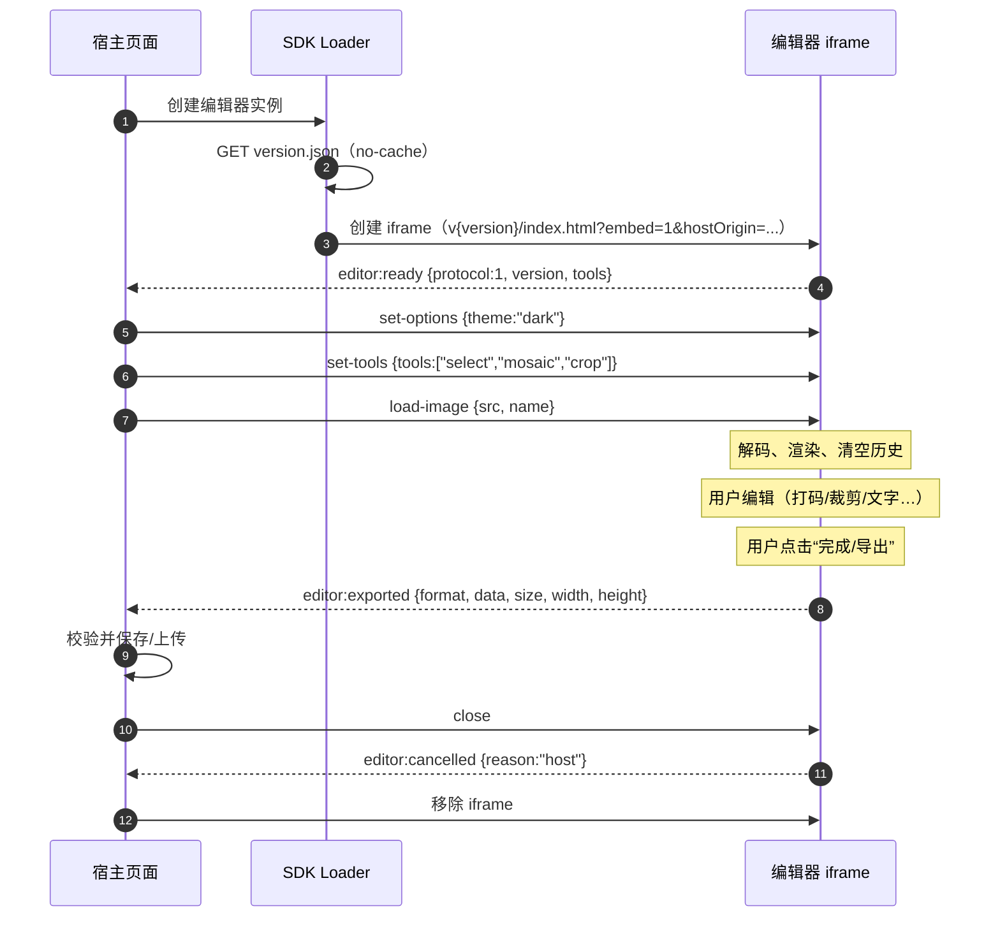
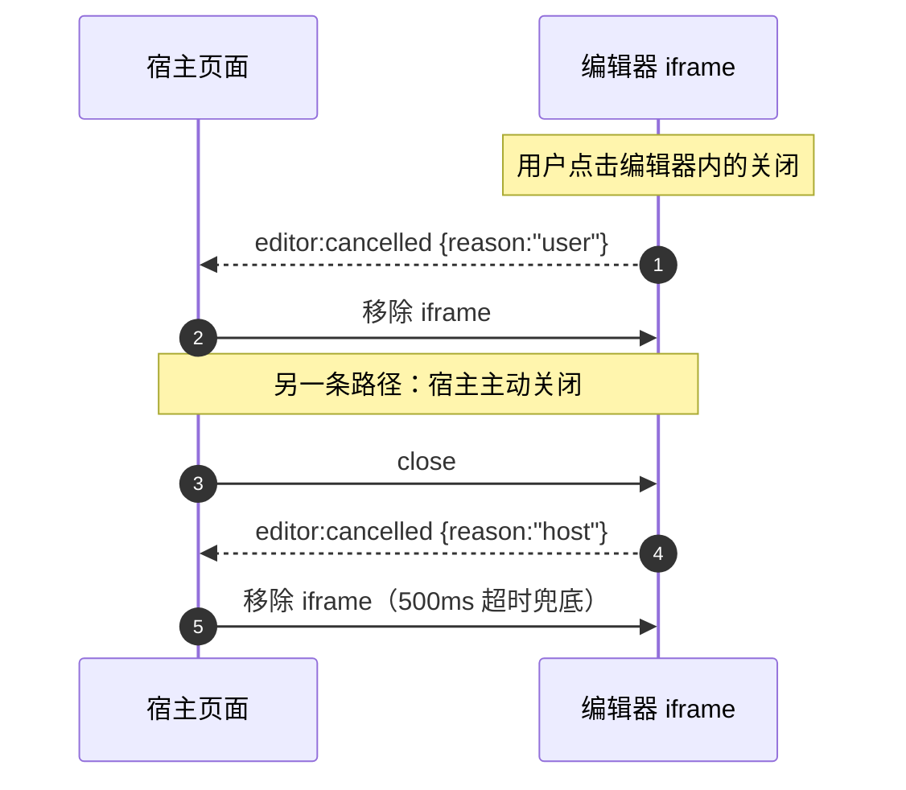
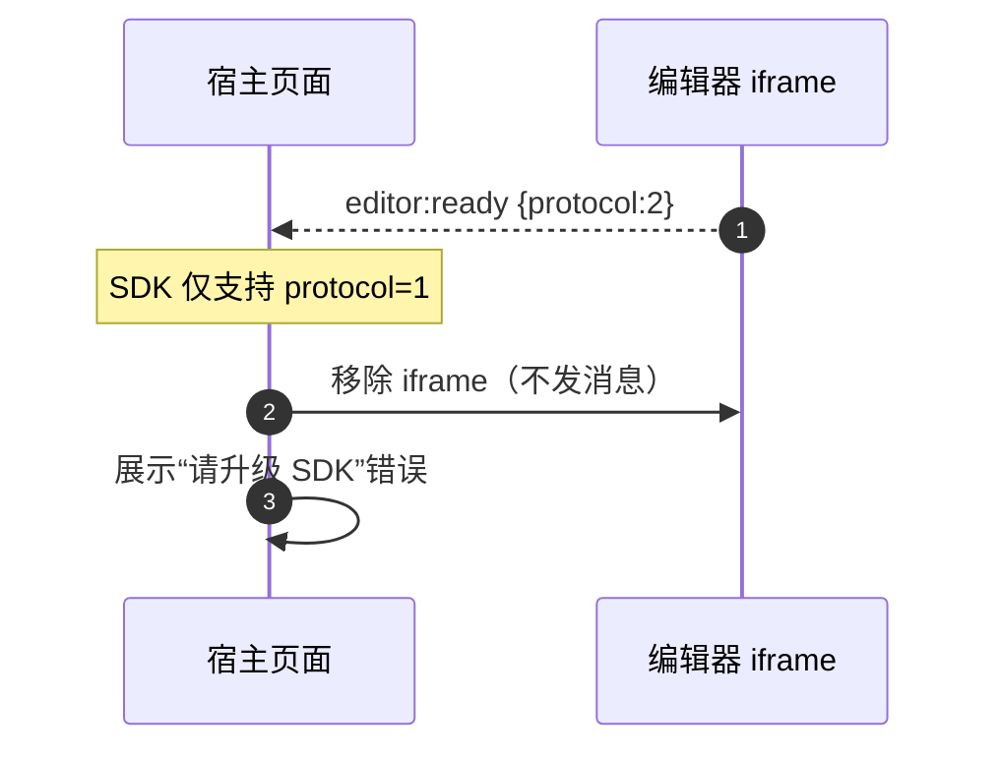

# 图片工具箱 · iframe 嵌入通信协议

> 文档状态：**已冻结（v1）** ｜ 协议版本：`1` ｜ 冻结日期：2026-10-29
> 适用场景：Web 端 iframe 嵌入模式（`?embed=1`）
> 相关文档：[VERSION_SPEC.md](VERSION_SPEC.md)（version.json 与强缓存契约）、[SDK_PLAN.md](SDK_PLAN.md)（整体方案）

---

## 0. 这份文档定义什么

本协议定义**宿主页面**与**图片工具箱编辑器 iframe**之间的全部通信行为：

- iframe 的启动参数与嵌入方式；
- 双向消息的封装格式、类型、载荷、触发时机与错误处理；
- `postMessage` 的 `targetOrigin`、来源校验等安全约定；
- 协议版本协商与向前兼容规则；
- 文档冻结时的实现状态、边界场景与后续落点。

**不定义**（属于其它文档或任务卡）：

| 内容 | 归属 |
|------|------|
| 宿主 SDK Loader 的公开 API（`new ImageToolbox(...)`） | 阶段 1（SDK Loader 卡） |
| version.json 字段、缓存头、版本路径 | [VERSION_SPEC.md](VERSION_SPEC.md) |
| 编辑器内部 UI、按钮布局 | 阶段 2（嵌入模式卡） |
| 账号、付费、云存储 | 不在本次嵌入方案范围 |

### 0.1 设计原则

1. **够用就停**：只有 4 个宿主命令 + 4 个编辑器事件，不引入 RPC 框架、心跳、requestId。
2. **单向信任**：编辑器只信任启动参数里声明的宿主 origin；宿主只信任 iframe 的真实 origin。
3. **失败可见**：任何宿主可感知的失败都必须落到 `editor:error`，不允许静默失败。
4. **向前兼容**：未知消息类型、未知字段、未知工具名一律忽略，不报错、不断连。
5. **版本化 URL + iframe 隔离**：协议本身不负责缓存，资源由 [VERSION_SPEC.md](VERSION_SPEC.md) 的版本化路径承载。

### 0.2 当前实现状态（冻结时的诚实说明）

截至 2026-10-29，仓库中**尚未实现**本协议：

| 能力 | 现状 |
|------|------|
| Web 入口 `clients/web/src/index.js` | 支持 `?img=<url>` 导入；无 `?embed=1` 分支 |
| `postMessage` 桥 | 不存在 |
| 导出行为 | 用户点导出即触发浏览器下载（`WebHostAdapter.saveImage`），无 `editor:exported` |
| `version.json` | 不存在，构建/部署仍为 `dist/web/index.html + app.js + index.css` 平铺结构 |

本文档是**阶段 1 / 阶段 2 的实现依据**。文档中的“必须”指实现验收要求，不是对现存代码的描述。

---

## 1. 角色与术语

| 术语 | 含义 |
|------|------|
| **宿主（host）** | 引入编辑器 iframe 的第三方页面，运行在宿主 origin 上 |
| **编辑器（editor）** | 运行在 iframe 内的图片工具箱 Web 版页面 |
| **SDK Loader** | 宿主页面里负责读取 version.json、拼 iframe URL、转发事件的一小段脚本（阶段 1 交付） |
| **origin** | 浏览器同源策略中的 `scheme://host[:port]`，**不含路径、查询串、末尾斜杠** |
| **命令** | 宿主 → 编辑器的消息 |
| **事件** | 编辑器 → 宿主的消息 |

约束：

- **一个 iframe = 一个编辑器实例**。同页多实例 = 多个 iframe，各自独立通信，靠 `event.source` 区分。
- 编辑器运行在**独立的 iframe 上下文**，不与宿主共享 DOM、CSS、JS 全局变量。
- 通信**只有一条通道**：`window.postMessage`。不使用 `document.domain`、不使用 `window.parent.xxx` 直接调用。

---

## 2. 嵌入方式与启动参数

### 2.1 iframe URL

```text
https://cdn.example.com/img-toolbox/v3.0.0/index.html?embed=1&hostOrigin=https%3A%2F%2Fapp.example.com
```

其中：

- `https://cdn.example.com/img-toolbox/v3.0.0/index.html` 来自 version.json 的 `assets["index.html"].url`（见 [VERSION_SPEC.md](VERSION_SPEC.md)）。
- `hostOrigin` 的值必须是**宿主 origin 的 URL 编码结果**，即 `encodeURIComponent(location.origin)`。

### 2.2 启动参数

| 参数 | 必需性 | 取值 | 说明 |
|------|--------|------|------|
| `embed` | 跨域嵌入**必须**为 `1` | `1` | 进入嵌入模式；缺省或其它值 = 普通 Web 页面 |
| `hostOrigin` | 跨域嵌入**必须**；同源可省 | 裸 origin | 编辑器只接受来自该 origin 的消息，也只向该 origin 发送消息 |
| `theme` | 可选 | `light` \| `dark` \| `system` | 首屏主题提示，避免主题闪烁；`set-options` 到达后以其为准 |

规则：

1. `hostOrigin` **必须**等于 `new URL(raw).origin` 的序列化结果（浏览器会把默认端口归一化）。带路径、查询串、末尾斜杠、`null`、`javascript:`、`file:` 一律视为非法，编辑器不进入嵌入模式并在控制台报错，**不发送 `editor:ready`**。
2. 同源嵌入（iframe origin === 宿主 origin）可以省略 `hostOrigin`；此时只接受同源消息，但 `targetOrigin` 仍**不得**使用 `'*'`。
3. 嵌入模式下的 `?img=` 参数**忽略**：图片一律经 `load-image` 进入，避免两套入口行为不一致。
4. 除上表参数外，编辑器不读取其它查询参数；宿主也不得依赖任何未文档化的参数。

### 2.3 iframe 标签建议

```html
<iframe
  id="img-toolbox"
  src="https://cdn.example.com/img-toolbox/v3.0.0/index.html?embed=1&hostOrigin=https%3A%2F%2Fapp.example.com"
  style="width:100%;height:640px;border:0"
  title="图片编辑器"
  allow="clipboard-write"
></iframe>
```

- 编辑器**铺满 iframe**（`width/height` 100%），不提供高度上报协议；尺寸完全由宿主 CSS 决定。
- 若使用 `sandbox`，**必须**同时包含 `allow-scripts allow-same-origin`；否则脚本无法运行、origin 退化为 `null`，协议无法工作。不要添加 `allow-top-navigation`。
- 不要给 iframe 设置 `loading="lazy"` 以外的延迟加载策略；编辑器初始化依赖页面可见。
- 跨域时 iframe 内是**第三方上下文**，第三方 Cookie 策略可能生效。因此嵌入模式默认**关闭账号登录入口**，见 §2.4。

### 2.4 嵌入模式（`embed=1`）的必需行为

| 行为 | 要求 |
|------|------|
| 布局 | 编辑器铺满 iframe，不出现页面级滚动条 |
| 账号 | 隐藏账号/登录入口（第三方上下文登录不可靠，且会让宿主页面出现越权入口） |
| 图片来源 | 只接受 `load-image`；隐藏“选择文件/拖入图片”入口，避免用户导入宿主不知道的图片 |
| 导出 | **不触发浏览器下载**，改为发送 `editor:exported`（见 §5.2） |
| 关闭 | 若提供用户可见的关闭入口，必须发送 `editor:cancelled`（`reason: "user"`） |
| 偏好持久化 | 嵌入模式下主题、布局等偏好**不得**写入编辑器 origin 的 localStorage（多个宿主共享同一 CDN origin，会互相串味）；`set-options` 只对当前实例生效 |

> 说明：阶段 2 若需要“允许本地导入”“显示账号”等能力，通过 `set-options` 的**新增可选字段**扩展，仍属协议 `1`。不要在 v1 中预先塞入开关。

---

## 3. 消息封装

### 3.1 信封格式

所有消息都是**可结构化克隆的 JSON 对象**：

```json
{
  "channel": "img-toolbox",
  "protocol": 1,
  "type": "load-image",
  "payload": { "src": "data:image/png;base64,..." }
}
```

| 字段 | 类型 | 必需 | 规则 |
|------|------|------|------|
| `channel` | string | 是 | 固定为 `"img-toolbox"`，用于过滤宿主页面上其它库的 postMessage 流量 |
| `protocol` | integer | 是 | 本协议版本，当前固定 `1` |
| `type` | string | 是 | 消息类型，见 §4、§5 |
| `payload` | object | 否 | 消息载荷；缺省视为 `{}`；**不得**为数组、字符串、函数、DOM 节点 |

`payload` 中的字段若为可选（表中标“否”），缺省时按文档给出的默认值处理。

### 3.2 收发规则

1. 接收方必须**先**校验 `channel`、`protocol`、`type`，再读取 `payload`；任一不符按 §3.3 处理，**不得**基于不可信数据执行 DOM/HTML 操作。
2. `channel` 不等于 `"img-toolbox"` → 静默忽略。
3. `channel` 匹配但 `protocol` 不等于接收方支持的版本 → 静默忽略并 `console.warn`（不回报错误，避免双方互相报错形成循环）。
4. `channel`、`protocol` 匹配但 `type` 未知 → 静默忽略（向前兼容，新版本可能新增消息）。
5. `type` 已知但 `payload` 结构不合法 → 编辑器发送 `editor:error`（`INVALID_MESSAGE`）；宿主侧对编辑器事件的非法载荷只记日志、不崩溃。
6. 命令按到达顺序处理；`load-image` 采用**最新优先**（§4.1）。
7. 单条消息建议 ≤ 32 MiB（postMessage 会复制数据）。编辑器对超过 **32 MiB** 的 `load-image.src` 直接返回 `LOAD_FAILED`，宿主应在上层先压缩/缩放图片。

### 3.3 不受信任消息的处理

| 场景 | 行为 |
|------|------|
| `event.origin` 不匹配 | 静默丢弃（可 `console.warn`），**绝不**回发任何消息 |
| `event.source` 不是预期窗口 | 静默丢弃 |
| 顶层不是普通对象 / `type` 不是字符串 | 静默丢弃（无法判断是否属于本协议） |
| 属于本协议但载荷非法 | 见 §3.2 第 5 条 |

---

## 4. 宿主 → 编辑器（命令）

命令只允许在收到 `editor:ready` **之后**发送。宿主应在 ready 前把命令排队（见 §10），编辑器不保证能收到 ready 之前的消息。

### 4.1 `load-image` — 加载/替换图片

**触发**：宿主就绪后立即发送；或在用户换图、重新打开时发送。

```json
{
  "channel": "img-toolbox",
  "protocol": 1,
  "type": "load-image",
  "payload": {
    "src": "data:image/png;base64,iVBORw0KGgo...",
    "name": "avatar.png"
  }
}
```

| 字段 | 类型 | 必需 | 说明 |
|------|------|------|------|
| `src` | string | 是 | 图片来源，取值规则见下表 |
| `name` | string | 否 | 建议文件名（仅用于导出时的默认文件名）；编辑器会做净化：取 basename、去控制字符、截断到 120 字符 |

`src` 允许的形式（与 Web 端 `?img=` 的来源白名单一致）：

| 形式 | 允许 | 说明 |
|------|------|------|
| `data:image/<mime>;base64,...` | ✅ | 必须是 **base64** 编码的 `data:image/*`；`data:text/html` 等非图片类型拒绝（SVG 允许，按图片处理） |
| `blob:<same-origin>/...` | ✅ | 仅限编辑器 origin 自身的 blob URL；跨源 blob 实际不可读，直接拒绝 |
| 同源相对路径 / 同源绝对 URL | ✅ | 以编辑器页面为基准解析 |
| 跨源 `https://` | ✅ 有条件 | 图片服务器**必须**返回 CORS 头（编辑器以 `crossOrigin="anonymous"` 加载）。无 CORS 头 → `LOAD_FAILED`（不能因为画布被污染导致后续导出失败） |
| `http://`、`file:`、`javascript:`、`data:` 非图片 | ❌ | `LOAD_FAILED` |

行为约定：

1. **替换语义**：加载成功后清空撤销栈、图层列表与当前编辑内容，按“新会话”处理；随后发送编辑器的常规事件（无额外事件）。
2. **最新优先**：上一次 `load-image` 尚未完成时又收到新的，旧请求标记为 superseded，其成功/失败**都不再上报**；只上报最新一次的结果。
3. **成功无回执**：成功不单独发事件（避免为了 loading 状态增加协议面）；编辑器内部显示加载状态。宿主需要感知失败时，只能依赖 `editor:error`，因此**失败必须上报**。
4. **失败**：发送 `editor:error`，`code` 为 `LOAD_FAILED`，`fatal: false`；编辑器保留当前画面（若已有图片）或空状态，允许宿主重发。

**错误处理**：网络失败、CORS 失败、解码失败、`src` 超长/非法 → `LOAD_FAILED`（见 §6）。

### 4.2 `set-tools` — 限定可用工具

**触发**：ready 后、加载图片前后均可；用于按业务场景裁剪工具栏（例如只允许打码 + 裁剪）。

```json
{
  "channel": "img-toolbox",
  "protocol": 1,
  "type": "set-tools",
  "payload": {
    "tools": ["select", "mosaic", "crop"]
  }
}
```

| 字段 | 类型 | 必需 | 说明 |
|------|------|------|------|
| `tools` | string[] | 是 | 允许的工具名列表，至少 1 项 |

合法工具名（v1）：

| 名称 | 功能 |
|------|------|
| `select` | 移动/框选 |
| `mosaic` | 打码（马赛克/模糊） |
| `crop` | 剪切 |
| `color` | 调色 |
| `brush` | 画笔 |
| `eraser` | 橡皮擦 |
| `text` | 文字 |
| `shape` | 图形 |
| `sticker` | 贴纸 |

行为约定：

1. 工具按列表**白名单**生效：未列出的工具从工具栏隐藏，快捷键失效。
2. 未知工具名**忽略**（向前兼容：新版本工具发给旧编辑器时不报错）。
3. `tools` 为空数组 → `INVALID_MESSAGE`，保留上一次的工具集合。
4. 若列表中没有任何一个合法工具（全是未知名字）→ `INVALID_MESSAGE`，保留上一次的工具集合。
5. 当前激活的工具被移除时，自动切回列表中第一个合法工具。
6. 命令幂等：重复发送相同列表无副作用。
7. 恢复全部工具：发送全部 9 个工具名（v1 不提供“重置”魔法值，避免空数组语义歧义）。

**错误处理**：载荷非法 → `editor:error`（`INVALID_MESSAGE`，`detail.field = "tools"`），不改动当前状态。

### 4.3 `set-options` — 运行时配置

**触发**：ready 后任意时刻；可重复发送，逐项覆盖。

```json
{
  "channel": "img-toolbox",
  "protocol": 1,
  "type": "set-options",
  "payload": {
    "theme": "dark",
    "locale": "zh-CN"
  }
}
```

| 字段 | 类型 | 必需 | 取值 | 说明 |
|------|------|------|------|------|
| `theme` | string | 否 | `light` \| `dark` \| `system` | 缺省 `light`；`system` 跟随 `prefers-color-scheme` |
| `locale` | string | 否 | `zh-CN` | 缺省 `zh-CN`；v1 仅支持中文，其它值忽略并回报 `INVALID_MESSAGE` |

行为约定：

1. 逐字段应用；**未知字段忽略**（向前兼容）；已识别字段的非法值 → 忽略该字段并发送 `INVALID_MESSAGE`（`detail.field` 指出字段），其余字段照常生效。
2. 配置只对当前 iframe 实例生效，**不写入 localStorage**（嵌入模式约束，见 §2.4）。
3. 主题、语言变更立即生效，不需要重载 iframe。
4. 命令幂等。

**错误处理**：非法值 → `INVALID_MESSAGE`；不会导致编辑器不可用。

### 4.4 `close` — 结束编辑会话

**触发**：宿主主动销毁编辑器前（例如用户点了宿主的“关闭/取消”按钮、宿主路由切换）。

```json
{
  "channel": "img-toolbox",
  "protocol": 1,
  "type": "close"
}
```

- `payload` 可省略；v1 不定义任何字段（预留），编辑器忽略未知字段。
- 编辑器行为：停止交互、执行 `App.destroy()` 清理（事件订阅、定时器、画布），然后**尽力**发送一次 `editor:cancelled`（`reason: "host"`），随后忽略所有后续消息。
- 宿主行为：发送 `close` 后启动 **500ms** 定时器；收到 `editor:cancelled` 或超时后移除 iframe。**不得**假定一定收到回执（iframe 可能已经崩溃/被浏览器冻结）。
- 若编辑器已经发送过 `editor:exported` 或 `editor:cancelled`，`close` 只做清理，不改变宿主已经拿到的结果。
- 重复 `close` 幂等。

**错误处理**：不产生 `editor:error`（关闭路径上的失败没有补救意义，宿主按时移除 iframe 即可）。

---

## 5. 编辑器 → 宿主（事件）

事件由编辑器主动发送，宿主按 `type` 分发。所有事件都必须满足 §3.1 的信封格式。

### 5.1 `editor:ready` — 编辑器就绪

**触发**：仅当 `embed=1` 且桥接层与 `App` 初始化均成功后，编辑器**每次页面加载只发送一次** ready（iframe 刷新/重新创建 = 新实例，会再发一次）。初始化失败（Fabric 未加载、致命异常）不发 ready，宿主只能通过 ready 超时感知。

**宿主必须先挂监听再创建 iframe**：`editor:ready` 可能在 iframe 导航完成的第一时间发出，晚注册监听会永久丢失它。

```json
{
  "channel": "img-toolbox",
  "protocol": 1,
  "type": "editor:ready",
  "payload": {
    "protocol": 1,
    "version": "3.0.0",
    "tools": ["select", "mosaic", "crop", "color", "brush", "eraser", "text", "shape", "sticker"]
  }
}
```

| 字段 | 类型 | 说明 |
|------|------|------|
| `protocol` | integer | 编辑器实现的协议版本（当前 `1`） |
| `version` | string | 编辑器应用版本（`APP_VERSION`，可能带 `-dev` 等 SemVer 预发布标识） |
| `tools` | string[] | 当前可用工具名，便于宿主决定 `set-tools` 的内容 |

宿主处理：

1. 校验 `protocol` 是否在自身支持范围内（v1 SDK 支持 `1`）；不支持 → 移除 iframe 并按宿主自身错误 UI 处理（**不**通过本协议交互）。
2. 记录 `version` 与 `tools`，用于日志、灰度与能力判断。
3. 按“先配置、后加载”的顺序发送 `set-options` / `set-tools` / `load-image`。
4. 若 ready 在 **10 秒**内未到达，视为加载失败（iframe 404、脚本异常、被杀进程），宿主销毁 iframe 并提示重试。

> 注意：ready 在图片加载**之前**发送。不要用 ready 判断“图片已显示”。

### 5.2 `editor:exported` — 用户完成导出

**触发**：嵌入模式下，用户在编辑器内确认导出（`导出`/`完成`按钮）。

```json
{
  "channel": "img-toolbox",
  "protocol": 1,
  "type": "editor:exported",
  "payload": {
    "format": "png",
    "data": "data:image/png;base64,iVBORw0KGgo...",
    "size": 204800,
    "width": 1920,
    "height": 1080,
    "name": "avatar.png"
  }
}
```

| 字段 | 类型 | 说明 |
|------|------|------|
| `format` | string | `png` \| `jpeg` \| `webp`（小写） |
| `data` | string | 图片 data URL；MIME 必须与 `format` 一致（jpeg 对应 `data:image/jpeg`） |
| `size` | integer | 解码后的字节数（不是 data URL 字符串长度） |
| `width` / `height` | integer | 导出图片的像素尺寸 |
| `name` | string | 建议文件名；由 `load-image.name` 派生，缺省为 `edited.<ext>` |

行为约定：

1. **不下载文件**：嵌入模式下禁止触发 `<a download>` / 宿主保存对话框；唯一出口是本事件。
2. **v1 没有宿主触发导出的命令**：导出只能由编辑器内的用户操作触发；宿主不要试图用自定义消息让编辑器导出（后续若要支持，按 §9 以新增可选命令的方式演进）。
3. **会话不结束**：导出后编辑器保持打开，用户可继续编辑或再次导出；由宿主决定何时发 `close`。
4. 导出失败（画布过大、内存不足、画布被污染）→ `editor:error`（`EXPORT_FAILED`），不发送 `editor:exported`。
5. 宿主需要校验：`data` 前缀与 `format` 匹配、`size` 与 data URL 解码长度一致（容差 0）、`width/height` 为正整数；不合法按宿主自身错误处理，**不得**直接写入 DOM 或拼 HTML。
6. 同一会话允许多次导出；宿主以最后一次为准或自行追加记录。

**错误处理**：`EXPORT_FAILED`，`fatal: false`；宿主提示用户降低分辨率/重试。

### 5.3 `editor:cancelled` — 会话结束且无导出结果

**触发**（两种，语义都是“本次编辑没有产出”）：

1. 用户点击编辑器内的关闭/取消入口 → `reason: "user"`；
2. 编辑器收到宿主 `close` → `reason: "host"`（回执，见 §4.4）。

```json
{
  "channel": "img-toolbox",
  "protocol": 1,
  "type": "editor:cancelled",
  "payload": { "reason": "user" }
}
```

| 字段 | 类型 | 说明 |
|------|------|------|
| `reason` | string | `user` \| `host`；缺省 `user` |

宿主处理：

- `reason: "user"`：关闭编辑器 UI，移除 iframe，不做保存。
- `reason: "host"`：`close` 的回执；忽略内容，按计划移除 iframe。
- 每个实例最多收到一次 `editor:cancelled`；收到后编辑器不再响应任何消息。
- 如果宿主已经收到 `editor:exported`，仍可能随后收到 `editor:cancelled`（`reason: "host"`）：它只表示会话结束，**不代表导出作废**。

**错误处理**：无。

### 5.4 `editor:error` — 错误上报

**触发**：命令执行失败、或编辑器内部不可恢复异常（初始化失败除外，后者宿主只能通过 ready 超时感知）。

```json
{
  "channel": "img-toolbox",
  "protocol": 1,
  "type": "editor:error",
  "payload": {
    "code": "LOAD_FAILED",
    "message": "图片加载失败",
    "detail": { "field": "src", "reason": "cors" },
    "fatal": false
  }
}
```

| 字段 | 类型 | 必需 | 说明 |
|------|------|------|------|
| `code` | string | 是 | 错误码枚举，见 §6 |
| `message` | string | 是 | 可直接展示给用户的简短中文（≤ 80 字） |
| `detail` | object | 否 | 调试信息；**不得**包含 token、Cookie、完整 data URL、用户隐私 |
| `fatal` | boolean | 否 | `true` = 编辑器已不可用，宿主必须移除 iframe；缺省 `false` |

行为约定：

1. 一次失败只发一条错误，不重试、不循环上报。
2. 同一错误不得按帧/按帧率重复发送。
3. `detail` 中不得回传完整的 `data`/`src`（可能很大或含敏感图），只允许错误分类与字段名。
4. 宿主对未知 `code` 按 `INTERNAL_ERROR` 处理（向前兼容）。

---

## 6. 错误码枚举

| code | 触发场景 | 建议 `fatal` | 宿主处理 |
|------|----------|--------------|----------|
| `INVALID_MESSAGE` | 命令 `payload` 结构/取值非法：`tools` 为空或全为未知项、`theme/locale` 非法值等 | `false` | 修正参数后重发；不要自动无限重试 |
| `LOAD_FAILED` | `load-image.src` 非法、超过 32 MiB、网络/CORS 失败、图片解码失败 | `false` | 展示错误、允许换图；保留 iframe |
| `EXPORT_FAILED` | `canvas.toDataURL` 失败、内存不足、画布被跨域图片污染 | `false` | 提示降低分辨率或重试；保留 iframe |
| `INTERNAL_ERROR` | 未捕获异常、状态机损坏等兜底 | `true` | 上报宿主监控，移除 iframe，提示重试 |

约定：

- 新增错误码属于**非破坏性变更**（协议保持 `1`）；宿主必须容忍未知 code。
- 错误码只增不改；不复用旧 code 表达新语义。
- `INVALID_MESSAGE` 的 `detail` 应包含 `{ type, field }`，方便宿主定位是哪条命令哪个字段。

---

## 7. 时序图

### 7.1 正常流程：加载 → 编辑 → 导出 → 关闭



### 7.2 加载失败

```mermaid
sequenceDiagram
    autonumber
    participant H as 宿主页面
    participant I as 编辑器 iframe

    I-->>H: editor:ready
    H->>I: load-image {src:"https://img.example.com/a.png"}
    Note over I: 图片服务器未返回 CORS 头
    I-->>H: editor:error {code:"LOAD_FAILED", message:"图片加载失败", fatal:false}
    H->>H: 展示错误 + 重试按钮
    H->>I: load-image {src:"data:image/png;base64,..."}
    Note over I: 加载成功（无回执）
```

### 7.3 用户取消 / 宿主关闭



### 7.4 握手失败（协议不兼容）



---

## 8. 安全约定（强制）

### 8.1 targetOrigin

| 发送方 | `postMessage` 的 targetOrigin | 接收方校验 |
|--------|------------------------------|------------|
| 编辑器 iframe | 启动参数中的 `hostOrigin`；同源嵌入未提供时为 `location.origin`；**禁止** `'*'` | `event.origin === hostOrigin`（或同源时的 `location.origin`）且 `event.source === window.parent` |
| 宿主页面 | `new URL(iframe.src).origin`；**禁止** `'*'` | `event.origin === editorOrigin` 且 `event.source === iframe.contentWindow` |

补充规则：

- `editorOrigin` 必须从 iframe 的最终 URL 解析，不要从配置字符串拼接。
- 多实例页面中，`event.source` 是区分实例的**唯一可靠依据**；不要用消息内容里的任何自报标识。
- 编辑器在 ready 之前的消息（如果浏览器有）也按同一 origin 规则校验。

### 8.2 hostOrigin 的信任边界

`hostOrigin` 来自 iframe URL，**嵌入者可以把它设成自己的 origin**。这不是缺陷：

- 编辑器没有任何高权限能力（不读宿主 DOM、不读宿主存储、不带账号凭据）；
- 每个嵌入者只能与自己加载的编辑器实例通信，互相隔离；
- 真正要防的是**第三方页面冒充宿主**向 iframe 发消息，`hostOrigin` + `event.source` 已覆盖。

**不要**把以下内容当作安全边界：`Referer`、UA、消息里的 `from` 字段、iframe 的 `name`。

### 8.3 载荷校验

- 所有字段先校验类型/长度再使用，禁止把宿主字符串直接 `innerHTML`、`eval`、拼 CSS。
- `load-image.name` 只用于文件名建议，编辑器必须净化（basename、去控制字符、截断）。
- `load-image.src` 必须经过 §4.1 的来源白名单校验；禁止把 `src` 直接塞进 `` 再信任其加载结果。
- `editor:exported.data` 只接受 `data:image/(png|jpeg|webp);base64,` 前缀；宿主不得把 `data` 当 HTML/JS 使用。
- 不通过 postMessage 传递凭据、Token、Cookie、账号信息；嵌入模式不接入账号体系。

### 8.4 响应头约束（编辑器页面）

- 编辑器页面**不得**返回 `X-Frame-Options: DENY/SAMEORIGIN`（会直接阻止嵌入）。
- 若配置 CSP，`frame-ancestors` 必须允许宿主页面（或省略）；**不要**用 `frame-ancestors 'none'`。
- 资源响应使用 `X-Content-Type-Options: nosniff`。
- 版本化资源的缓存头见 [VERSION_SPEC.md](VERSION_SPEC.md)。

---

## 9. 版本协商与兼容性

### 9.1 协议版本

- 当前协议版本：`1`。信封里的 `protocol` 与 `editor:ready.payload.protocol` 必须一致且为 `1`。
- **非破坏性变更**（协议版本不变）：新增可选字段、新增消息类型、新增错误码、新增工具名、新增 `set-options` 字段。双方必须忽略不认识的内容。
- **破坏性变更**（协议版本 +1）：删除/重命名字段、改变字段语义、改变命令顺序要求、改变错误上报语义。
- 协议版本与资源版本（`version.json.version`）**解耦**：编辑器升级到 `3.x` 但协议仍是 `1` 很常见；SDK 不要用应用版本号判断协议能力，用 `editor:ready.payload.protocol`。

### 9.2 握手失败处理

- SDK 支持的协议集合（v1：`{1}`）与 `ready.payload.protocol` 无交集 → 移除 iframe，展示升级提示。
- 编辑器遇到不支持的 `protocol` 命令 → 忽略 + `console.warn`，不回报（见 §3.2）。
- 未收到 ready → 10 秒超时，宿主销毁 iframe。

### 9.3 与 version.json 的关系

- 编辑器 URL 由 version.json 决定（见 [VERSION_SPEC.md](VERSION_SPEC.md)）；同一时刻打开的不同实例可以运行不同资源版本，但协议必须与 SDK 兼容。
- version.json 不可用时的降级顺序也在 VERSION_SPEC.md 中定义；本协议不重复。

---

## 10. 边界场景约定

| # | 场景 | 约定 |
|---|------|------|
| 1 | iframe 404 / 脚本加载失败 | 宿主 `onload` 后 ready 超时（10s）→ 销毁 + 重试入口；不通过协议交互 |
| 2 | ready 前宿主发了命令 | 宿主必须排队，ready 后按序 flush；编辑器不保证收到 |
| 3 | 连续两次 `load-image` | 最新优先；旧的完成/失败都不上报；只保留最后一次结果 |
| 4 | `load-image` 进行中收到 `close` | 取消当前加载（标记 superseded），执行关闭，回 `cancelled(host)` |
| 5 | 重复 `editor:exported` | 允许（用户多次导出）；宿主以最后一次为准或自行处理 |
| 6 | 导出后收到 `close` 再收到 `cancelled(host)` | `cancelled` 仅表示会话结束，不影响已导出的结果 |
| 7 | 用户取消后又发命令 | 编辑器已销毁，命令被忽略；宿主不应再发 |
| 8 | 同一页面多个 iframe | 每个实例独立 ready/事件；宿主按 `event.source` 路由 |
| 9 | iframe 刷新 / 浏览器恢复 | 视为新实例：重新发 ready；宿主重置状态并重新下发配置与图片 |
| 10 | 宿主页面卸载 | 直接移除 iframe；`beforeunload` 中不要等待异步 postMessage |
| 11 | 恶意第三方页面伪造消息 | origin/source 校验不通过 → 静默丢弃 |
| 12 | 超大图片 data URL | > 32 MiB → `LOAD_FAILED`；宿主应先压缩 |
| 13 | 消息 `payload` 含函数/DOM 节点 | postMessage 本身会抛 `DataCloneError`；发送方必须只用 JSON 数据 |
| 14 | 组件在 iframe 内全屏（Fullscreen API） | 不在 v1 协议范围；宿主不要让 iframe 依赖全屏 |

---

## 11. 实现落点建议（阶段 2，非协议约束）

以下只是为了让协议可落地，不构成接口冻结：

| 能力 | 建议位置 | 备注 |
|------|----------|------|
| 解析 `embed` / `hostOrigin` / `theme` | `clients/web/src/index.js` 或新增 `clients/web/src/embedParams.js` | 纯函数，便于单测 |
| postMessage 桥（收发、校验、队列） | `clients/web/src/embedBridge.js` | 留在 client 层；`core/` 不得直接使用 `window`（AGENTS.md §3） |
| 驱动 App 加载图片/应用配置/关闭 | 经 HostAdapter 能力域或 EventBus 内部事件 | 不要从桥接层直接调用 `App` 的私有方法 |
| 导出拦截 | `ExportModule` 增加“嵌入模式导出”分支，或由 `WebHostAdapter` 提供 embed 能力 | 嵌入模式绝不走 `saveImage`/下载 |
| `set-tools` 白名单 | `ToolManager` / `Toolbar` | 隐藏按钮 + 禁用快捷键 + 激活工具回退 |
| `set-options.theme` | `utils/theme.js` 的 `applyThemeChoice(choice, false)` | 不持久化 |
| `close` | `App.destroy()` | 同时清理桥接层监听器与定时器 |

验收自测建议（阶段 2）：

1. 正常路径：ready → load-image → 导出 → close，宿主收到全部事件；
2. 跨域：`hostOrigin` 不同、`event.origin` 伪造、`event.source` 伪造均被丢弃；
3. 错误路径：非法 `src`、无 CORS 图片、空 `tools`、未知工具名、未知字段；
4. 时序：连续 `load-image`、加载中 `close`、导出后 `close`、多实例并存；
5. 版本：协议不兼容时 SDK 不崩溃、给出明确错误；iframe 刷新后重新握手。

---

## 12. 参考实现（最小示例）

### 12.1 宿主侧

```js
const ENTRY = 'https://cdn.example.com/img-toolbox/v3.0.0/index.html';
const HOST_ORIGIN = location.origin;
const EDITOR_ORIGIN = new URL(ENTRY).origin;

const iframe = document.createElement('iframe');
iframe.title = '图片编辑器';

let ready = false;
const queue = [];

function send(type, payload) {
  const message = { channel: 'img-toolbox', protocol: 1, type };
  if (payload !== undefined) message.payload = payload;
  iframe.contentWindow.postMessage(message, EDITOR_ORIGIN);
}

function whenReady(fn) {
  ready ? fn() : queue.push(fn);
}

// 先挂监听，再设置 src：ready 可能在导航完成的第一时间发出。
window.addEventListener('message', (event) => {
  if (event.source !== iframe.contentWindow) return;
  if (event.origin !== EDITOR_ORIGIN) return;

  const msg = event.data;
  if (!msg || msg.channel !== 'img-toolbox' || msg.protocol !== 1) return;

  switch (msg.type) {
    case 'editor:ready':
      if (msg.payload.protocol !== 1) {
        iframe.remove();
        // 提示 SDK/编辑器版本不兼容
        return;
      }
      ready = true;
      queue.splice(0).forEach(fn => fn());
      send('set-options', { theme: 'dark' });
      send('load-image', { src: myImageDataUrl, name: 'avatar.png' });
      break;

    case 'editor:exported':
      // 1) 校验 data 前缀与 format；2) 上传/保存；3) 关闭
      saveExport(msg.payload);
      send('close');
      break;

    case 'editor:cancelled':
      iframe.remove();
      break;

    case 'editor:error':
      console.error('[img-toolbox]', msg.payload.code, msg.payload.message);
      if (msg.payload.fatal) iframe.remove();
      break;

    default:
      // 未知事件：忽略（向前兼容）
      break;
  }
});

iframe.src = `${ENTRY}?embed=1&hostOrigin=${encodeURIComponent(HOST_ORIGIN)}`;
document.querySelector('#editor-slot').appendChild(iframe);
```

### 12.2 编辑器侧（伪代码）

```js
const params = new URLSearchParams(location.search);
const embedded = params.get('embed') === '1';

function readHostOrigin() {
  const raw = params.get('hostOrigin');
  if (!raw) return location.origin; // 同源嵌入
  try {
    const origin = new URL(raw).origin;
    return origin === raw ? origin : null; // 必须是裸 origin
  } catch {
    return null;
  }
}

if (embedded) {
  const hostOrigin = readHostOrigin();
  if (!hostOrigin) {
    console.error('[embed] 非法 hostOrigin，拒绝嵌入');
  } else {
    // 1) 初始化 App 后发送 ready
    // 2) 只接受 origin===hostOrigin && source===parent 的消息
    // 3) 所有发送使用 parent.postMessage(msg, hostOrigin)
  }
}
```

---

## 13. Review 记录

| 日期 | 方式 | 结论 | 处理 |
|------|------|------|------|
| 2026-10-29 | 独立 review（对照源码与 DoD 检查项） | 待补充 | — |
